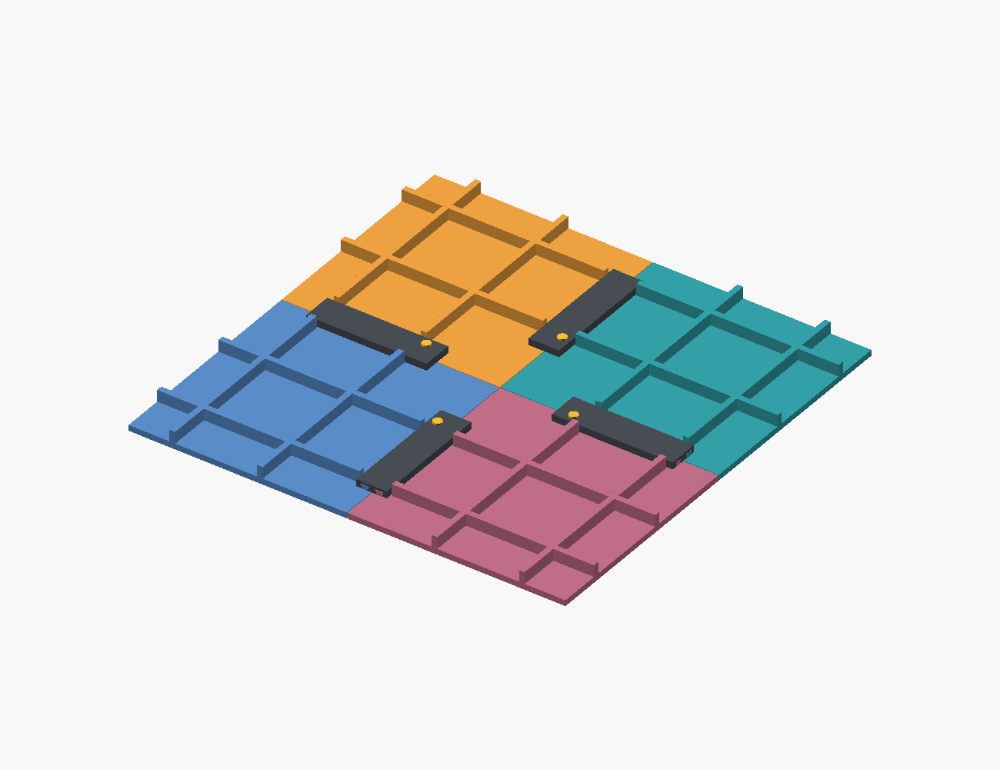

# V7 — ray thấp nối các phần đáy

Mở `thung-rac-4-goc-v7.scad`. V7 thay khóa chìm V6 bằng hai ray đực hình thang và một nắp trượt ôm cả hai mép đáy. Ray dài 80 mm giúp truyền lực qua một đoạn mép ghép; chốt ngắn chỉ giữ nắp khỏi trượt ngược. Chưa có thử tải để xác nhận độ bền thực tế.



Ray cao 3 mm trên đáy dày 4 mm. Khi lắp, nắp cao tới Z=9 mm, đầu chốt tới Z=10,2 mm; gân đáy có sẵn cao tới Z=12 mm. Gân và ray nối qua tấm đáy, không tiếp xúc trực tiếp với nhau. Gân tam giác và bo chân đáy–thành giữ như V6. V6 và các bản cũ được giữ nguyên; script Fusion vẫn V4.

| File trong `exports/v7/` | Số lượng | Kích thước bao khi in (mm) |
|---|---:|---|
| `corner.stl` | 4 | 195,8 × 195,8 × 240 |
| `key.stl` — khóa thành | 4 | 236 × 12 × 32 |
| `pin.stl` — chốt thành | 4 | Xem audit.json |
| `floor_key.stl` — nắp ray | 4 | 21 × 83 × 4,75 |
| `floor_pin.stl` — chốt ray | 4 | 6 × 6 × 4,2 |
| `floor_coupon.stl` — hai nửa mẫu thử | 1 bộ | 36 × 32 × 12 |
| `floor_coupon_key.stl` — nắp mẫu thử | 1 | 21 × 27 × 4,75 |

Cụm chính gồm 20 chi tiết. Coupon không tính vào cụm. `audit/` chứa thể tích quét dùng kiểm tra va chạm, không dùng để in.

## Hướng in và thử FDM

STL đã xuất đúng hướng: góc thùng đặt đáy xuống bàn; nắp ray **úp mặt rộng xuống bàn, rãnh hướng lên**; chốt ray đặt đầu tròn xuống bàn. Giữ hướng này khi đưa vào slicer. Mặt nghiêng ray khoảng 45°, thân đáy không có hốc khóa chìm cần bắc mái như V6.

In thử hai nửa `floor_coupon.stl`, một `floor_coupon_key.stl` và một `floor_pin.stl` trước. Khe hở ray mặc định 0,25 mm theo pháp tuyến bề mặt; đây là giá trị khởi đầu, cần chỉnh theo máy và nhựa. Mẫu ngắn dùng để kiểm tra khe và chốt; nắp 80 mm vẫn cần thử riêng vì cong vênh và ma sát có thể tăng theo chiều dài. Chốt dùng lắp ép nhẹ, chưa đo lực tháo/lắp.

Slice offline bằng Bambu Studio 02.08.02.61, fixture Prusa MK3S 0,4 / lớp 0,20 / Generic PLA, support tắt, giữ hướng STL: cả coupon, nắp coupon, nắp dài và chốt đều trả mã 0, không cảnh báo, `support_used=false`, không có đường đùn support. Coupon có 2 đoạn Bridge / 276 bước đùn XY dương; nắp dài có 4 / 719. Các đoạn bridge vẫn cần quan sát khi in thật. Đây là fixture chẩn đoán, chưa phải profile máy người dùng; chưa slice nguyên góc thùng V7. Xem `exports/v7/slice-audit.json`; 3MF/G-code và fixture giữ local tại `work/v7-slice/`.

## Lắp và tháo

1. Ghép bốn góc, lắp khóa và chốt thành như V6.
2. Đưa nắp ray vào từ vùng tâm, đầu có vai chặn hướng về tâm; trượt ra phía thành cho tới khi vai chạm đầu ray. Làm lần lượt cả bốn đường ghép.
3. Lắp chốt ngắn từ trên xuống lỗ trên nắp và ray. Vai chặn giữ chiều tiến, chốt giữ chiều lùi; các mặt nghiêng giữ hai mép đáy khỏi tách và lệch cao độ.
4. Tháo chốt trước, kéo nắp về tâm rồi nhấc ra. Không cần lật thùng để tiếp cận khóa đáy.

Xem `floor_joint_section.png` và `floor_joint_exploded.png` để kiểm tra chiều lắp. Các đường ghép chưa kín nước. Chưa xác minh lực chịu tải, độ dão theo thời gian, độ bám lớp hoặc khả năng xách thùng đầy.

## Tham số và kiểm chứng

`floor_rail_length=80`, `floor_rail_start=46`, `floor_rail_clearance=0.25`, `floor_pin_interference=0.05`, `floor_rib_start=11`. Không kéo dài ray chỉ bằng cách sửa chiều dài: vị trí bắt đầu phải đủ chỗ cho vai hai nắp đối diện đi qua khi lắp. Source có assert giới hạn đường lắp, khoảng cách gân và vị trí ray.

```powershell
$env:OPENSCAD = 'H:\OpenSCAD\portable\OpenSCAD-2026.09.29-x86-64\openscad.com'
& 'H:\OpenSCAD\work\toothbrush-tools\Scripts\python.exe' build-v7.py
& 'H:\OpenSCAD\work\toothbrush-tools\Scripts\python.exe' verify-v7-variants.py
```

Có thể dùng Python cài dependency trong `requirements.txt` và OpenSCAD Manifold ở đường dẫn khác. Không chạy audit với Python `-O`.

Kiểm tra CAD mặc định: mesh kín, số component, mặt đặt bàn, 190 cặp trong 20 chi tiết; kiểm tra giữ mép ±X/±Z, vai/chốt chống trượt, đường quét liên tục của bốn nắp khi các nắp khác đã lắp, đường đưa chốt và coupon. Chốt lắp ép được kiểm tra riêng với phần giao thể tích cho phép. Ba chi tiết khóa đáy mới có diện tích mặt dưới vượt 45° phía trên bàn bằng 0 theo mesh; đây không phải chứng nhận in không support.

Bốn biến thể kích thước/chiều dài/khe hở đạt audit; ba cấu hình sai và Python `-O` bị từ chối. Review độc lập không có finding hình học/lắp ráp. Kết quả CAD ở `exports/v7/audit.json`; kết quả slice lưu riêng. Chưa in vật lý hoặc thử tải. Tài liệu hãng đã lưu theo [chỉ mục tham khảo](docs/REFERENCES.md).
