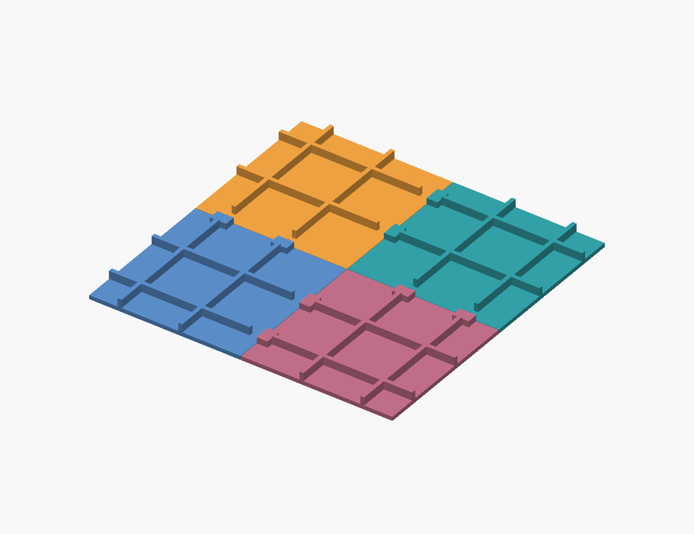
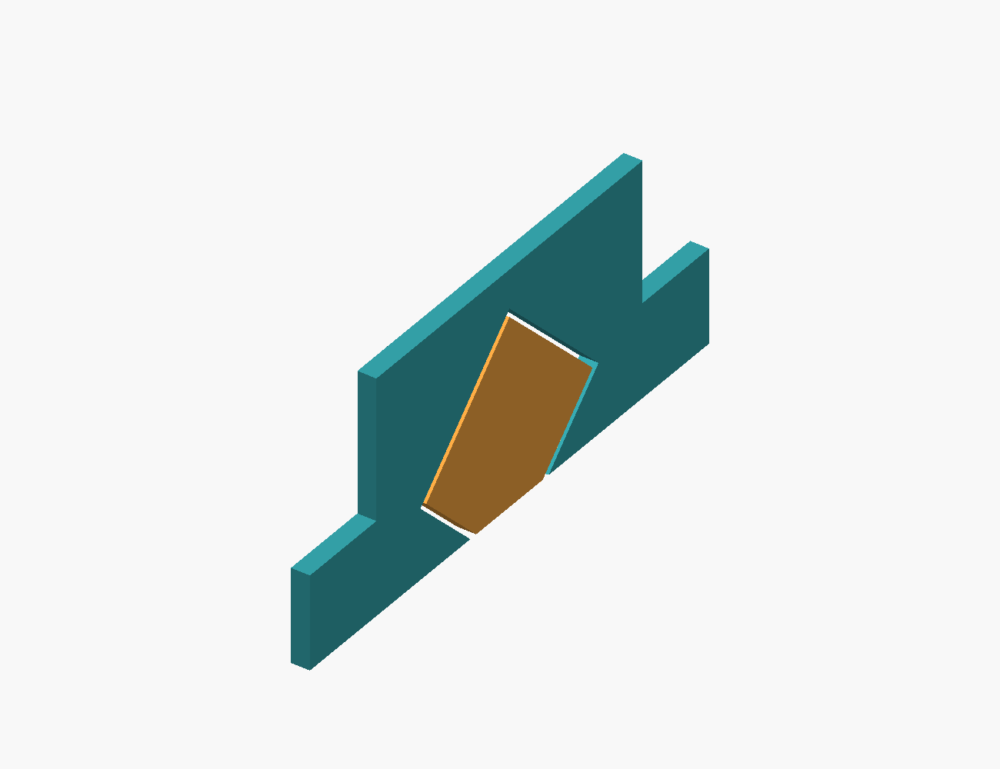

# V8 — ray ghép in liền với đáy

Mở `thung-rac-4-goc-v8.scad`. Mỗi đường ghép có hai ray ngắn đúc liền vào mép đáy và hai rãnh nhận trên góc đối diện. Không in nắp ray hoặc chốt đáy rời. Bốn khóa và bốn chốt thành giữ các góc khỏi rút ra sau khi ghép; tổng cụm **12 chi tiết**.



Ray cắm ngang **vuông góc đường ghép**, sâu 8 mm; không cần trượt dọc hết đường ghép. Tiết diện rộng 4 mm tại mặt bàn, rộng 10 mm tại Z=3 mm và thu về đỉnh tại Z=8 mm. Rãnh ôm tiết diện này để cản lệch cao độ cả hai chiều. Gốc ray gắn 3 mm vào đáy của nó. Rãnh sâu 8,25 mm mặc định; khe hở theo pháp tuyến 0,25 mm. Vỏ rãnh cao 10 mm từ mặt bàn, nhô 6 mm trên đáy dày 4 mm, thấp hơn gân đáy Z=12 mm.



## Chi tiết và thứ tự lắp

Bốn góc khác vị trí ray đực/cái. **In mỗi STL góc một bản**, không in bốn bản của cùng một STL. Tất cả STL góc được xuất trong hệ tọa độ góc phần tư +X/+Y để in; xoay quanh Z theo bảng khi lắp.

| STL trong `exports/v8/` | Số lượng | Xoay khi lắp | Kích thước bao in (mm) |
|---|---:|---:|---|
| `corner_ne.stl` | 1 | 0° | 195,8 × 204 × 240 |
| `corner_nw.stl` | 1 | 90° | 204 × 204 × 240 |
| `corner_sw.stl` | 1 | 180° | 204 × 195,8 × 240 |
| `corner_se.stl` | 1 | 270° | 195,8 × 195,8 × 240 |
| `key.stl` — khóa thành | 4 | Theo đường ghép | 236 × 12 × 32 |
| `pin.stl` — chốt thành | 4 | Theo đường ghép | 8 × 17 × 4 |

Nhìn từ trên: NE ở +X/+Y, NW ở −X/+Y, SW ở −X/−Y, SE ở +X/−Y.

1. Ghép NE vào NW bằng cách đưa NE từ phía +X trượt về −X. Chưa lắp khóa thành.
2. Ghép SE vào SW theo cùng chiều để tạo nửa phía nam.
3. Đặt nửa phía bắc ở phía +Y, trượt cả nửa về −Y vào nửa phía nam. Cần giữ hai đáy cùng cao độ. Hai đường ghép còn lại ăn đồng thời; góc cuối không phải lắp riêng vào hai ray vuông góc đã khóa.
4. Sau khi đủ bốn góc và các mép đã về đúng vị trí, đưa bốn khóa thành từ trên xuống rồi lắp chốt thành từ ngoài vào.
5. Tháo theo thứ tự ngược: chốt/khóa thành trước, tách hai nửa theo Y, sau đó tách từng nửa theo X. Không cố nhấc riêng một góc theo Z khi ray còn ăn khớp.

Khóa thành là phần giữ ray khỏi rút theo phương cắm. Ray đáy tự giữ lệch Z, không tự khóa chiều rút. Gân, gusset và bo chân đáy–thành giữ từ V7; các đường ghép vẫn cần túi lót và chưa kín nước. V7 được giữ riêng; Fusion hiện vẫn V4.

## In FDM

Giữ mặt đáy STL xuống bàn. Ray và mái rãnh có các mặt nghiêng 45°; không có nắp khóa đáy phải in úp riêng. In một bộ `floor_coupon.stl` trước: file gồm hai nửa đặt tách nhau trên bàn, hoặc dùng hai file `floor_coupon_male.stl` và `floor_coupon_female.stl`. Coupon không tính vào cụm chính. Kích thước nửa đực 26 × 24 × 8 mm; nửa cái 17,8 × 24 × 10 mm.

Khe mặc định là điểm bắt đầu để thử theo nhựa và máy. Kiểm tra rãnh không võng/bít, trượt hết hành trình bằng tay, giữ được hai chiều lên/xuống, và tháo được. Lắp thực tế phải kiểm tra cả hai ray cùng lúc và độ phẳng của tấm đáy lớn; coupon một ray không chứng minh điều đó.

Coupon đã slice offline với Bambu Studio 02.08.02.61, fixture Prusa MK3S 0,4 / lớp 0,20 / Generic PLA, support tắt và giữ hướng STL: mã trả 0, không cảnh báo, không đường đùn support. Slicer vẫn phân loại một số đường in là Bridge; cần xem chất lượng in thử. Kết quả góc nguyên và giới hạn profile được ghi riêng trong `exports/v8/slice-audit.json`; không lấy slice offline làm bằng chứng đã in thành công.

## Tham số và kiểm chứng

`floor_rail_depth=8`, `floor_rail_clearance=0.25`, `floor_socket_height=10`, `floor_rib_start=11`. Chiều sâu cho phép 6–10 mm; tăng chiều sâu phải tăng khoảng lùi gân tới ít nhất `depth+3`. Mái rãnh tối thiểu cao 10 mm từ bàn để còn khoảng 1,6 mm vật liệu trên đỉnh rãnh ở khe lớn nhất. Hình tiết diện ray giữ cố định; thay hình cần đồng bộ coupon và audit.

```powershell
$env:OPENSCAD = 'H:\OpenSCAD\portable\OpenSCAD-2026.09.29-x86-64\openscad.com'
& 'H:\OpenSCAD\work\toothbrush-tools\Scripts\python.exe' build-v8.py
& 'H:\OpenSCAD\work\toothbrush-tools\Scripts\python.exe' verify-v8-variants.py
```

Python cần dependency trong `requirements.txt`; runtime hoặc OpenSCAD có thể đổi đường dẫn. Không dùng Python `-O`.

Audit CAD kiểm tra mesh kín, số component, mặt đặt bàn và khổ XY giả định 250 mm; 66 cặp trong 12 chi tiết; giữ Z cả hai dấu trên bốn đường ghép; khóa thành cản rút ray. Thể tích quét toàn góc kiểm tra liên tục hai lượt ghép X và lượt ghép hai nửa theo Y. Thể tích quét được dựng từ hai vị trí đầu/cuối và lăng trụ của các tam giác dẫn, dùng Manifold Mesh64 để giữ độ chính xác. Đường đưa khóa thành và đoạn tiếp cận tự do của chốt cũng được kiểm tra; phần ép chốt cuối có giới hạn giao thể tích riêng. `audit/` chỉ chứa thể tích kiểm tra, không dùng để in.

Coupon có diện tích mặt dưới vượt 45° phía trên bàn bằng 0 theo mesh. Đây là tiêu chí hình học, không bảo đảm không cần support với mọi máy/nhựa. Audit không đo lực lắp, tải phá hủy, độ bám lớp, độ dão hoặc độ kín nước. Chưa in vật lý hoặc thử tải. Tài liệu FDM hãng đã lưu theo [chỉ mục tham khảo](docs/REFERENCES.md).
